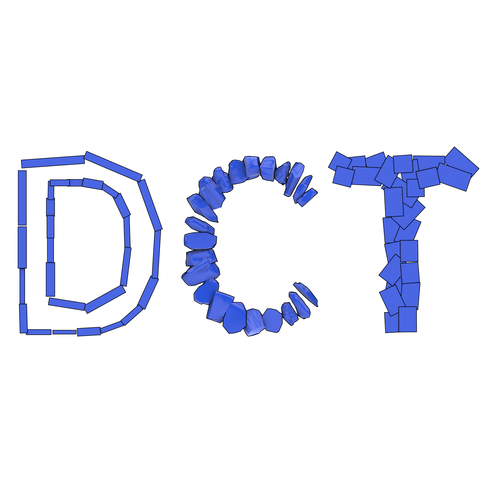
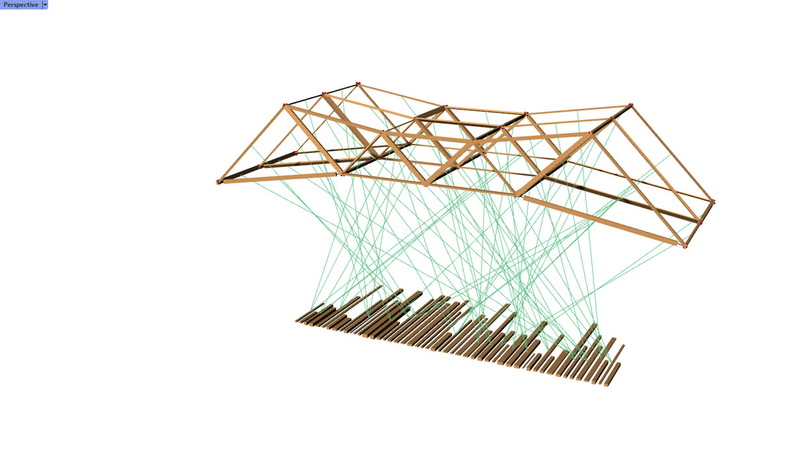
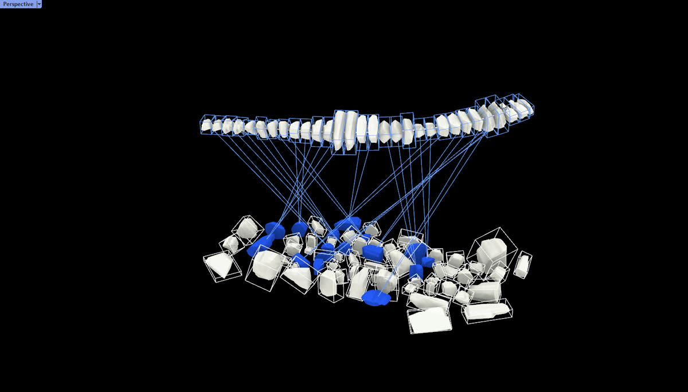

[](https://doi.org/10.5281/zenodo.10724610)



Available on [Food4Rhino](https://www.food4rhino.com/en/app/digitalcircularitytoolkit?lang=en).

**Documentation:** [keithjlee.com/DigitalCircularityToolkit](https://keithjlee.com/DigitalCircularityToolkit/dev/): concepts, worked workflows with example files, and a reference for every component.
# DigitalCircularityToolkit
A Grasshopper plugin to facilitate circular/reuse/inventory-driven design workflows, including:
- Extracting principal axes from arbitrary geometry
- Abstracing objects as primitive lines, planes, boxes, and spheres
- Knolling and alignment
- Shape characterization: LineScore, PlaneScore, BoxScore, SphereScore, RadialSignature
- Fourier shape descriptors (in complex and real coordinates) of radial signatures
- Custom feature vector definitions
- Optimal assignment
- Visualization tools for assignment

This toolkit provides a generalized approach to the Digital Circularity workflow outlined by [Cousin et al](https://scholar.google.com/citations?view_op=view_citation&hl=en&user=0RMLrVgAAAAJ&sortby=pubdate&citation_for_view=0RMLrVgAAAAJ:VLnqNzywnoUC).

## Installation
The latest build (v0.5) is available on [Food4Rhino](https://www.food4rhino.com/en/app/digitalcircularitytoolkit?lang=en) or in the releases page. Two packages are available: .NET 4.8 (Rhino 7, Windows + Mac) and .NET 8 (Rhino 8, Windows + Mac).

**v0.5 is the last release with Rhino 7 support.** Later versions target Rhino 8 and Rhino 9 only. The v0.5 changes were developed and tested in Rhino 8; they have not been tested in Rhino 7.

1. Find and download the latest build (.zip file) in the [releases](https://github.com/keithjlee/DigitalCircularityToolkit/releases) page.
2. Find your Grasshopper components folder by opening Grasshopper, then `File>Special Folders>Components Folder`
3. **For Windows users:** right click the downloaded .zip file and select `Properties`, and make sure that `Unblock` is checked.
4. Directly extract the contents of the .zip file to your Components Folder.
5. Restart Rhino/Grasshopper

## Citing
When using or extending this software for research purposes, please cite using the following:

### Bibtex
```
@software{lee_2024_10724610,
  author       = {Lee, Keith Janghyun},
  title        = {DigitalCircularityToolkit},
  month        = feb,
  year         = 2024,
  publisher    = {Zenodo},
  version      = {v0.5},
  doi          = {10.5281/zenodo.10724610},
  url          = {https://doi.org/10.5281/zenodo.10724610}
}
```

### Other styles
Or find a pre-written citation in the style of your choice [here](https://zenodo.org/records/10724610) (see the Citation box on the right side). E.g., for APA:
```
Lee, K. J. (2024). DigitalCircularityToolkit (v0.2). Zenodo. https://doi.org/10.5281/zenodo.10724610
```

# Examples
Each workflow is explained step by step in the [documentation](https://keithjlee.com/DigitalCircularityToolkit/dev/), with a downloadable example definition.

## Matching lengths to truss design
[](https://keithjlee.com/DigitalCircularityToolkit/dev/workflows/linear.html)

[Linear members from stock](https://keithjlee.com/DigitalCircularityToolkit/dev/workflows/linear.html): `LinearObject` with quantities, `FeatureVector`, `AsymmEuclideanDistance`, `Match`, `AlignToObject`, `MatchLines`. Structural analysis (e.g. Karamba3D) can supply further features.

## Beading curves with rocks
[](https://keithjlee.com/DigitalCircularityToolkit/dev/workflows/scans.html)

[Scanned objects](https://keithjlee.com/DigitalCircularityToolkit/dev/workflows/scans.html): `LinearObject` and `BoxObject` from scanned meshes, `BoxScore`, `Knoll`, `OverridePCA` for custom orientations.

## Tiling rocks into a Voronoi plane
[](https://keithjlee.com/DigitalCircularityToolkit/dev/workflows/shapes.html)

[Matching by shape](https://keithjlee.com/DigitalCircularityToolkit/dev/workflows/shapes.html): `PlanarObject`, `PlanarOutline`, `RadialSignature` and `HarmonicAnalysisComplex` feature vectors from the stones' outlines.

# Development Notes
- This plugin was developed by Keith J. Lee, PhD Candidate (Associaton: MIT > Architecture > Building Technology > Digital Structures >).
- [Karl-Johan Soerensen](https://github.com/soerensenkarl) developed I/O functionality for read/write workflows with Google Sheets and local .CSV files. To be released publicly in the near future.
- Initial release was given to students taking the IAP2024 design workshop: *4.181 Digital Circularity: Tooling up for reuse with Odds & Mods*
- Public release coincides with the S2024 design workshop: *4.185 ODDS & MODS Castaways*
  
# Release Notes
## v0.5 (final Rhino 7 release)
> **Rhino 7:** this is the last release with Rhino 7 support. Its changes have not been tested in Rhino 7 (developed and tested in Rhino 8).

Bug fixes, much faster object analysis, and a few deliberate behaviour changes. Saved definitions open unchanged: no components or parameters were removed or renamed. The harmonics components gain one optional input.

**Behaviour changes**
- Principal axes are now computed with a built-in solver instead of Accord.NET (removed). The axes are the same, but their *directions* now follow a fixed rule: PCA1 points towards +X, PCA2 towards +Y, and PCA3 = PCA1 × PCA2 (always a right-handed frame). Some objects therefore have flipped axes compared with v0.4. Where an axis is mathematically undefined (straight lines, perfect squares, spheres), its direction may differ from v0.4.
- `HausdorffDistanceCurve` / `HausdorffDistancePoints` are now symmetric (the larger of both directions), as documented. Previously only one direction was measured.
- `ManhattanDistance` now rounds up like the other distance matrices (it used to round down).
- `HarmonicAnalysisReal` / `HarmonicAnalysisComplex` were reading the FFT output wrongly, and now return true Fourier descriptors, so values change. Values are in model units and no longer depend on the sample count.
  - Real: the amplitudes of harmonics 1, 2, 3, ... (N samples give N/2). Previously the real and imaginary parts were listed as separate values, starting with a constant 0, and the last 1–2 samples were dropped.
  - Complex: ordered |c1|, |c-1|, |c2|, |c-2|, ..., so a short `FVLength` keeps the lowest frequencies. The samples are oriented counter-clockwise first, so reversed and mirrored curves give the same descriptor (previously they did not, because the fitted plane's normal direction is arbitrary). `Signature` also accepts Grasshopper complex numbers.
  - New optional `Normalize` input on both (default false, so existing definitions are unchanged). It makes the descriptor ignore size: Real divides by the mean radius, Complex by |c1| (its first value is then 1).
  - `RadialSignature`'s `DistanceSignature` is now the distance measured in the plane, as documented. It was the 3D distance; the two are the same for planar curves.
- `RotatePCA`, `AlignToPlane`, `AlignToObject` and `Knoll` keep the object type (e.g. a `LinearObject` stays a `LinearObject`, with its quantity, buffers and area), so their outputs can go straight into the Set components. Objects are moved with their axes instead of being re-analysed.
- The `Hulls` outputs of `BoxSet`/`SphereSet` and `VolumeHull` of `ObjectProperties` are only computed when connected or when the component preview is on.

**Fixes**
- `Match` and `Hungarian` no longer crash when there is more demand than supply: unassigned demand gets assignment `-1`, `Cost` sums the assigned items only, and a remark gives the count. `MatchLines` outputs an empty (null) line for unassigned demand.
- `OverridePCA` no longer modifies the upstream object (results no longer depend on solve order).
- `PlanarObject` now uses the `Thickness` input (it was ignored).
- `PlanarOutline` no longer fails on boxes.
- Object constructors accept SubDs, extrusions and surfaces, and report an error for unsupported geometry instead of producing an empty object. A buffer ≤ 0 is an error.
- Set components skip empty items with a warning instead of failing.
- `FrechetDistance` no longer risks a stack overflow on long curves. Distance components check that every feature vector has the same length.
- Very large costs no longer wrap around to negative values on Windows/Rhino 7.

**Performance**
- Object analysis is several times faster (up to about 10× for heavy meshes; Brep boxes about 4×), runs in parallel across items, and skips work that is never used (3D hulls, mass properties).
- Building distance matrices is up to about 9× faster for large inventories.

## Dec 15 2024
- `Hungarian` is now an obsolete component (still available to use for older projects) and is superseded by `Match`. This uses the Jonker-Volgenant matching algorithm, and results in a 100-500x speed improvement.
- New Distance Matrix generator `ManhattanDistance` computes the Manhattan distances between feature vectors (e.g., sum of components distance)
- `Frechet` computes the Frechet distance between two open curves
- `HausdorffCurve` and `HausdorffPoints` computes the Hausdorff distance between two closed curves or two sets of points.

## Feb 28 2024
- `v0.2` was released to enable Zenodo DOI and add minor description changes in some components. No functional changes.


