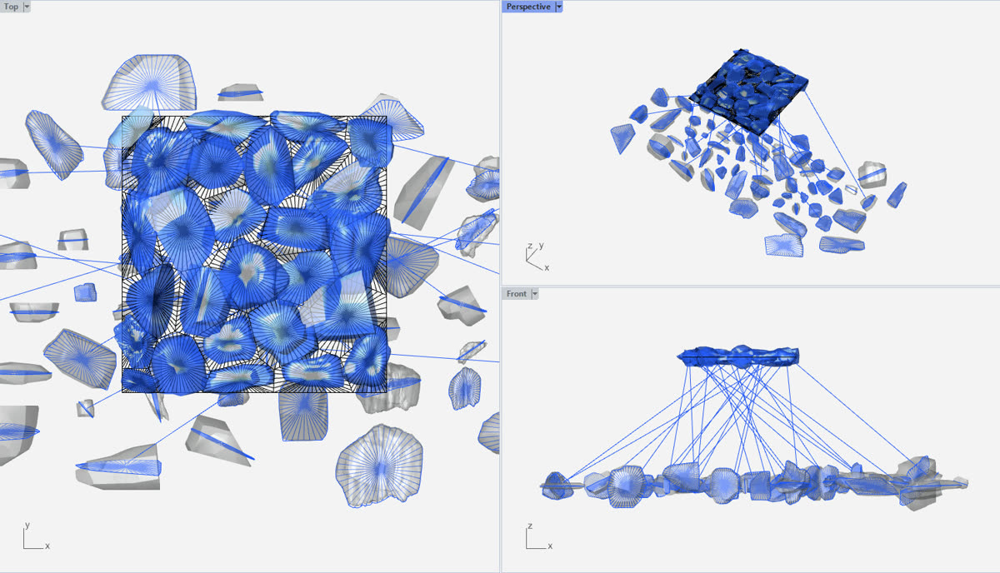

[](https://doi.org/10.5281/zenodo.10724609)


Available on [Food4Rhino](https://www.food4rhino.com/en/app/digitalcircularitytoolkit?lang=en).

**Documentation:** [keithjlee.com/DigitalCircularityToolkit](https://keithjlee.com/DigitalCircularityToolkit/dev/): concepts, worked workflows with example files, and a reference for every component.
# DigitalCircularityToolkit
A Grasshopper plugin to facilitate circular/reuse/inventory-driven design workflows, including:
- Extracting principal axes from arbitrary geometry
- Abstracing objects as primitive lines, planes, boxes, and spheres
- Knolling and alignment
- Shape characterization: LineScore, PlaneScore, BoxScore, SphereScore, RadialSignature
- Fourier shape descriptors (in complex and real coordinates) of radial signatures
- Custom feature vector definitions
- Optimal assignment
- Visualization tools for assignment

This toolkit provides a generalized approach to the Digital Circularity workflow outlined by [Cousin et al](https://scholar.google.com/citations?view_op=view_citation&hl=en&user=0RMLrVgAAAAJ&sortby=pubdate&citation_for_view=0RMLrVgAAAAJ:VLnqNzywnoUC).

## Installation
Major releases are on [Food4Rhino](https://www.food4rhino.com/en/app/digitalcircularitytoolkit?lang=en); every release, including bug-fix releases, is on the [releases](https://github.com/keithjlee/DigitalCircularityToolkit/releases) page. Two packages are available: .NET 4.8 (Rhino 7, Windows + Mac) and .NET 8 (Rhino 8, Windows + Mac).

**v0.5.x is the last release line with Rhino 7 support.** Later versions target Rhino 8 and Rhino 9 only. The v0.5.x changes were developed and tested in Rhino 8; they have not been tested in Rhino 7.

1. Find and download the latest build (.zip file) in the [releases](https://github.com/keithjlee/DigitalCircularityToolkit/releases) page.
2. Find your Grasshopper components folder by opening Grasshopper, then `File>Special Folders>Components Folder`
3. **For Windows users:** right click the downloaded .zip file and select `Properties`, and make sure that `Unblock` is checked.
4. Directly extract the contents of the .zip file to your Components Folder.
5. Restart Rhino/Grasshopper

## Citing
When using or extending this software for research purposes, please cite using the following (from [Zenodo](https://doi.org/10.5281/zenodo.24454793)):

### Bibtex
```
@software{keith_j_lee_2026_24454793,
  author       = {Keith J. Lee and
                  Karl-Johan Soerensen},
  title        = {keithjlee/DigitalCircularityToolkit:
                   DigitalCircularityToolkit v0.6
                  },
  month        = nov,
  year         = 2026,
  publisher    = {Zenodo},
  version      = {v0.6},
  doi          = {10.5281/zenodo.24454793},
  url          = {https://doi.org/10.5281/zenodo.24454793},
}
```

### APA
```
Keith J. Lee, & Karl-Johan Soerensen. (2026). keithjlee/DigitalCircularityToolkit: DigitalCircularityToolkit v0.6 (Version v0.6) [Computer software]. Zenodo. https://doi.org/10.5281/zenodo.24454793
```

This cites the latest release, v0.6 ([10.5281/zenodo.24454793](https://doi.org/10.5281/zenodo.24454793)). To cite DCT without a specific version, use the concept DOI [10.5281/zenodo.10724609](https://doi.org/10.5281/zenodo.10724609), which always resolves to the newest release. Other citation styles: see the Citation box on the [Zenodo record](https://doi.org/10.5281/zenodo.24454793).

# Examples
Each workflow is explained step by step in the [documentation](https://keithjlee.com/DigitalCircularityToolkit/dev/), with a downloadable example definition.

## Matching lengths to truss design
[](https://keithjlee.com/DigitalCircularityToolkit/dev/workflows/linear.html)

[Linear members from stock](https://keithjlee.com/DigitalCircularityToolkit/dev/workflows/linear.html): `LinearObject` with quantities, `FeatureVector`, `AsymmEuclideanDistance`, `Match`, `AlignToObject`, `MatchLines`. Structural analysis (e.g. Karamba3D) can supply further features.

## Beading curves with rocks
[](https://keithjlee.com/DigitalCircularityToolkit/dev/workflows/scans.html)

[Scanned objects](https://keithjlee.com/DigitalCircularityToolkit/dev/workflows/scans.html): `LinearObject` and `BoxObject` from scanned meshes, `BoxScore`, `Knoll`, `OverridePCA` for custom orientations.

## Tiling rocks into a Voronoi plane
[](https://keithjlee.com/DigitalCircularityToolkit/dev/workflows/shapes.html)

[Matching by shape](https://keithjlee.com/DigitalCircularityToolkit/dev/workflows/shapes.html): `PlanarObject`, `PlanarOutline`, `RadialSignature` and `HarmonicAnalysisComplex` feature vectors from the stones' outlines.

# Development Notes
- This plugin was developed by Keith J. Lee, PhD Candidate (Associaton: MIT > Architecture > Building Technology > Digital Structures >).
- [Karl-Johan Soerensen](https://github.com/soerensenkarl) developed I/O functionality for read/write workflows with Google Sheets and local .CSV files. To be released publicly in the near future.
- Initial release was given to students taking the IAP2024 design workshop: *4.181 Digital Circularity: Tooling up for reuse with Odds & Mods*
- Public release coincides with the S2024 design workshop: *4.185 ODDS & MODS Castaways*
  
# Release Notes
## Unreleased (next: v0.7)
- **Better orientation.** Every object constructor has a new `Orientation` input (Auto, PCA, MinBox, Legacy) and an optional `Plane`. **Auto**, the default for newly placed components:
  - takes the principal axes of the shape itself (mesh triangles by area, Breps through a render mesh, the region of a closed outline, curves by length), so axes no longer depend on how finely an object is meshed;
  - aligns square and near-square plates, and square or round members, with a side (minimum-area rectangle) instead of an arbitrary angle;
  - takes the edges of box Breps exactly.
- **Saved files keep their results:** constructors in files from v0.6 and earlier open in Legacy mode.
- Shapes with no preferred direction (an exact square, a round section, a sphere) get a reproducible frame and a remark; use the `Plane` input to set it.
- Analysis stays fast: a 160k-vertex scan in about 7 ms, a filleted Brep in about 5 ms.

## v0.6
A new, much faster matching pipeline, typed design objects, and correct planar hulls. **Rhino 8 only** (Rhino 7 users: stay on v0.5.2). Existing definitions open and compute as before, apart from the fixes listed below.

**Install:** copy *all* files from the zip into your Grasshopper Libraries folder (or one subfolder of it). The package now has two more DLLs next to the `.gha`: `DigitalCircularityToolkit.Numerics.dll` and `DigitalCircularityToolkit.Geometry.dll`. The `LapjvCSharp.dll` and `HungarianAlgorithm.dll` of earlier versions are no longer used and can be deleted.

### New: cost matrices and Assign
- `EuclideanCost`, `AsymmEuclideanCost` and `ManhattanCost` build a **CostMatrix**: exact decimal costs (no rounding up to integers), passed between components as one item instead of a tree of numbers. Building and passing a 2000×2000 matrix takes milliseconds instead of seconds. Powers can be decimals.
- `Assign` finds the lowest-cost assignment. It handles more demand than supply and forbidden pairs: unserved demand gets `-1`, listed in the new `Unassigned` output.
  - Matching on one feature, such as length, is solved by sorting: milliseconds for thousands of pieces.
  - Matching on several features uses a new exact solver for large problems: 2000×2000 pieces with 8 features in about 0.2 s (over 4 s with the old Match).
- `AsymmEuclideanCost` can forbid supply that is too small (`ForbidShortfall`) instead of only penalizing it.
- `CostMatrixToTree` shows the individual costs.
- The old `EuclideanDistance`, `AsymmEuclideanDistance`, `ManhattanDistance` and `Match` are hidden from the toolbar and keep working in saved files. To upgrade a definition, swap each for its new counterpart; the inputs are the same. The documentation examples use the new components.

### New: typed design objects
- Design objects travel on **DesignObject** wires instead of generic ones. Panels and tooltips show the object type, ID and size (`LinearObject 'B-12' L=3200 W=100 H=50`). An object wired into a Plane, Box or Geometry input gives its local plane, local box or source geometry. A wrong object type is reported at the input.
- Objects are immutable: a modifier (OverridePCA, RotatePCA, AlignToPlane, AlignToObject, Knoll) always returns a new object of the same type and never changes its input.
- Building an object from a heavy mesh is about 20× faster: hulls are only computed when an output needs them.

### Fixes
- **Planar hulls** are correct on sampled geometry. Grasshopper's convex hull solver, used until now, sometimes returned self-overlapping outlines that were too long (a 1 m square slab's hull measured 7.85 m instead of 4 m), or outlines that left some sample points outside. Affects the `Hulls` outputs of the Set components, `PlanarHull`, `ObjectProperties.PlanarHull` and the `PlanarOutline` fallback. Hulls also have fewer redundant vertices.
- **Match was not always optimal.** The LapjvCSharp library behind `Match` sometimes returned slightly suboptimal assignments on rectangular problems (up to 0.05% too costly in tests). `Match` and the hidden `Hungarian` now use DCT's own solver, so reopened files can show a slightly lower `Cost` and different pairs; among equally cheap assignments the chosen pairs can also differ.

### For script (GhPython/C#) users
- Design objects are immutable. Their members (`PCA1`, `Localbox`, `Quantity`, ...) are read-only properties with the same names.
- Build objects with `LinearObject.Create(geometry, n, ...)` (and the same for the other types) instead of the constructors. Change them with `obj.Transformed(t)`, `obj.WithFrame(plane)` or `obj with { ... }`, which return a new object of the same type.
- `TransformedGeometry` now maps the object's local box to world XY, centred at the origin.
- Cost matrices and solvers are in `DigitalCircularityToolkit.Numerics` (`CostMatrix`, `CostFunctions`, `LinearAssignment`) and need no Rhino.

Tested in Rhino 8.37 on macOS.

## v0.5.2
Documentation and citation only; the plugin's behaviour is unchanged from v0.5.1.
- Citations use the Zenodo concept DOI [10.5281/zenodo.10724609](https://doi.org/10.5281/zenodo.10724609), which always resolves to the latest version (the README and docs cited the v0.2 record).
- Makes this the latest version on Zenodo again: v0.5 and v0.5.1 were archived out of order after the Zenodo–GitHub connection was repaired.

## v0.5.1
Bug fixes found while writing the [documentation](https://keithjlee.com/DigitalCircularityToolkit/). Saved definitions open unchanged (no component or parameter changes). Like v0.5, the Rhino 7 package is untested in Rhino 7.

**Changed results**
- `SphereScore` used π·r³ instead of (4/3)·π·r³ for the sphere volume (integer division) and counted hulls larger than that as empty, so well-sampled spheres scored worst. Scores change.
- `RadialSignature` measures from the area centroid for closed planar curves (as design objects do), not the curve's length centroid. `DistanceSignature`, `Rays` and `HarmonicAnalysisReal` results change; `HarmonicAnalysisComplex` does not.
- `OverridePCA` now updates values derived from the bounding box: the estimated `Area` of a `LinearObject`, the sphere of a `SphericalObject`, and the planar hull (which was offset from the new local plane).
- `SphericalObject` includes the end point of open curves when computing the radius.
- `PlanarOutline` returns the outer boundary (largest loop) when the outline has holes or several parts, with a remark; it returned whichever loop came first.
- `ManhattanDistance` numbers its output branches `{0}, {1}, ...` like the other distance matrices.

**Errors instead of crashes or invalid numbers**
- `FeatureVector` stops with an error naming the input when the inputs have different lengths (it could crash).
- `BoxScore`, `PlaneScore`, `LineScore` and `SphereScore` warn instead of returning infinite or NaN scores for flat, straight or degenerate objects.
- `Normalize` and `PairNormalize` report an error when the largest value is not positive (it gave infinite values or flipped signs).
- `PlanarHull` warns instead of failing when the sample points are collinear.
- Object constructors report an error for `NumSamples` < 1 (curves and Breps) or a negative `Quantity`.
- `RotatePCA` warns when `RotationAxis` is not 1, 2 or 3 (it still rotates about PCA3, as before).
- `AsymmEuclideanDistance` adds a remark when `Power2` ≤ `Power1`.

**Descriptions** corrected for `AsymmEuclideanDistance` (`Power1`/`Power2`), the score components (`Factor`), `Normalize`/`PairNormalize`, the Set components (`Centroids` is the bounding-box center), `PlanarOutline`, `Match`, `Object`, `LinearObject`, `PlanarObject`, `FrechetDistance` and `HausdorffDistanceCurve`.

## v0.5 (final Rhino 7 release)
> **Rhino 7:** this is the last release with Rhino 7 support. Its changes have not been tested in Rhino 7 (developed and tested in Rhino 8).

Bug fixes, much faster object analysis, and a few deliberate behaviour changes. Saved definitions open unchanged: no components or parameters were removed or renamed. The harmonics components gain one optional input.

**Behaviour changes**
- Principal axes are now computed with a built-in solver instead of Accord.NET (removed). The axes are the same, but their *directions* now follow a fixed rule: PCA1 points towards +X, PCA2 towards +Y, and PCA3 = PCA1 × PCA2 (always a right-handed frame). Some objects therefore have flipped axes compared with v0.4. Where an axis is mathematically undefined (straight lines, perfect squares, spheres), its direction may differ from v0.4.
- `HausdorffDistanceCurve` / `HausdorffDistancePoints` are now symmetric (the larger of both directions), as documented. Previously only one direction was measured.
- `ManhattanDistance` now rounds up like the other distance matrices (it used to round down).
- `HarmonicAnalysisReal` / `HarmonicAnalysisComplex` were reading the FFT output wrongly, and now return true Fourier descriptors, so values change. Values are in model units and no longer depend on the sample count.
  - Real: the amplitudes of harmonics 1, 2, 3, ... (N samples give N/2). Previously the real and imaginary parts were listed as separate values, starting with a constant 0, and the last 1–2 samples were dropped.
  - Complex: ordered |c1|, |c-1|, |c2|, |c-2|, ..., so a short `FVLength` keeps the lowest frequencies. The samples are oriented counter-clockwise first, so reversed and mirrored curves give the same descriptor (previously they did not, because the fitted plane's normal direction is arbitrary). `Signature` also accepts Grasshopper complex numbers.
  - New optional `Normalize` input on both (default false, so existing definitions are unchanged). It makes the descriptor ignore size: Real divides by the mean radius, Complex by |c1| (its first value is then 1).
  - `RadialSignature`'s `DistanceSignature` is now the distance measured in the plane, as documented. It was the 3D distance; the two are the same for planar curves.
- `RotatePCA`, `AlignToPlane`, `AlignToObject` and `Knoll` keep the object type (e.g. a `LinearObject` stays a `LinearObject`, with its quantity, buffers and area), so their outputs can go straight into the Set components. Objects are moved with their axes instead of being re-analysed.
- The `Hulls` outputs of `BoxSet`/`SphereSet` and `VolumeHull` of `ObjectProperties` are only computed when connected or when the component preview is on.

**Fixes**
- `Match` and `Hungarian` no longer crash when there is more demand than supply: unassigned demand gets assignment `-1`, `Cost` sums the assigned items only, and a remark gives the count. `MatchLines` outputs an empty (null) line for unassigned demand.
- `OverridePCA` no longer modifies the upstream object (results no longer depend on solve order).
- `PlanarObject` now uses the `Thickness` input (it was ignored).
- `PlanarOutline` no longer fails on boxes.
- Object constructors accept SubDs, extrusions and surfaces, and report an error for unsupported geometry instead of producing an empty object. A buffer ≤ 0 is an error.
- Set components skip empty items with a warning instead of failing.
- `FrechetDistance` no longer risks a stack overflow on long curves. Distance components check that every feature vector has the same length.
- Very large costs no longer wrap around to negative values on Windows/Rhino 7.

**Performance**
- Object analysis is several times faster (up to about 10× for heavy meshes; Brep boxes about 4×), runs in parallel across items, and skips work that is never used (3D hulls, mass properties).
- Building distance matrices is up to about 9× faster for large inventories.

## Dec 15 2024
- `Hungarian` is now an obsolete component (still available to use for older projects) and is superseded by `Match`. This uses the Jonker-Volgenant matching algorithm, and results in a 100-500x speed improvement.
- New Distance Matrix generator `ManhattanDistance` computes the Manhattan distances between feature vectors (e.g., sum of components distance)
- `Frechet` computes the Frechet distance between two open curves
- `HausdorffCurve` and `HausdorffPoints` computes the Hausdorff distance between two closed curves or two sets of points.

## Feb 28 2024
- `v0.2` was released to enable Zenodo DOI and add minor description changes in some components. No functional changes.


