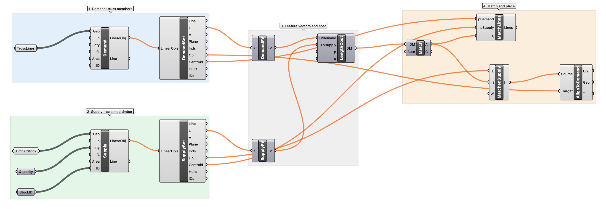

# Getting started

## Requirements

- **Rhino 8** (Service Release 14 or later), Windows or Mac. Use the `Rhino8-net8.0` package.
- **Rhino 7**: v0.5 is the last release with Rhino 7 support (`Rhino7-net48` package), and its changes have not been tested in Rhino 7. Later versions require Rhino 8 or newer.

## Installation

1. Download the latest `.zip` from the [releases page](https://github.com/keithjlee/DigitalCircularityToolkit/releases) (or from [Food4Rhino](https://www.food4rhino.com/en/app/digitalcircularitytoolkit?lang=en)).
2. In Grasshopper, open the components folder: **File > Special Folders > Components Folder**.
3. **Windows only:** right-click the downloaded `.zip`, choose **Properties**, and check **Unblock**.
4. Extract the contents of the `.zip` into the components folder. Keep the `.gha` and the `.dll` files together.
5. Restart Rhino and Grasshopper. The components appear in the **DigitalCircularityToolkit** tab.

## Your first match

The quickest way to see the whole chain is the first example, which matches the members of a truss to a stock of reclaimed timber.

1. Download [`01_linear_truss.gh`](assets/examples/01_linear_truss.gh) and open it in Grasshopper. The geometry (truss lines and timber pieces) is stored in the file.
2. Follow the four groups from left to right:
   - **1 Demand:** the truss lines become [`LinearObject`](@ref comp-LinearObject)s and a [`LinearSet`](@ref comp-LinearSet).
   - **2 Supply:** the timber Breps become `LinearObject`s with a `Quantity` and an `ID`, expanded by a second `LinearSet`.
   - **3 Feature vectors and cost:** each piece is described by its effective length ([`FeatureVector`](@ref comp-FeatureVector)), and [`AsymmEuclideanDistance`](@ref comp-AsymmEuclideanDistance) penalizes timber that is too short.
   - **4 Match and place:** [`Match`](@ref comp-Match) assigns one timber piece to every truss member, [`MatchLines`](@ref comp-MatchLines) draws the assignment, and [`AlignToObject`](@ref comp-AlignToObject) moves each matched piece onto its member.
3. Preview the `MatchLines` and `AlignToDemand` outputs in the Rhino viewport.

[Linear members from stock](workflows/linear.md) explains each step and the choices behind it.

## Units

DCT does not convert units. Lengths, areas and costs are in the units of the Rhino document. Cost matrices are rounded up to whole numbers, so the scale of the feature values matters; see [Feature vectors and cost matrices](concepts/cost-matrices.md).

## Getting help

Ask questions and report bugs on [GitHub issues](https://github.com/keithjlee/DigitalCircularityToolkit/issues). Each component's runtime messages (the orange and red balloons on the canvas) are listed in the [Component reference](components/index.md).
