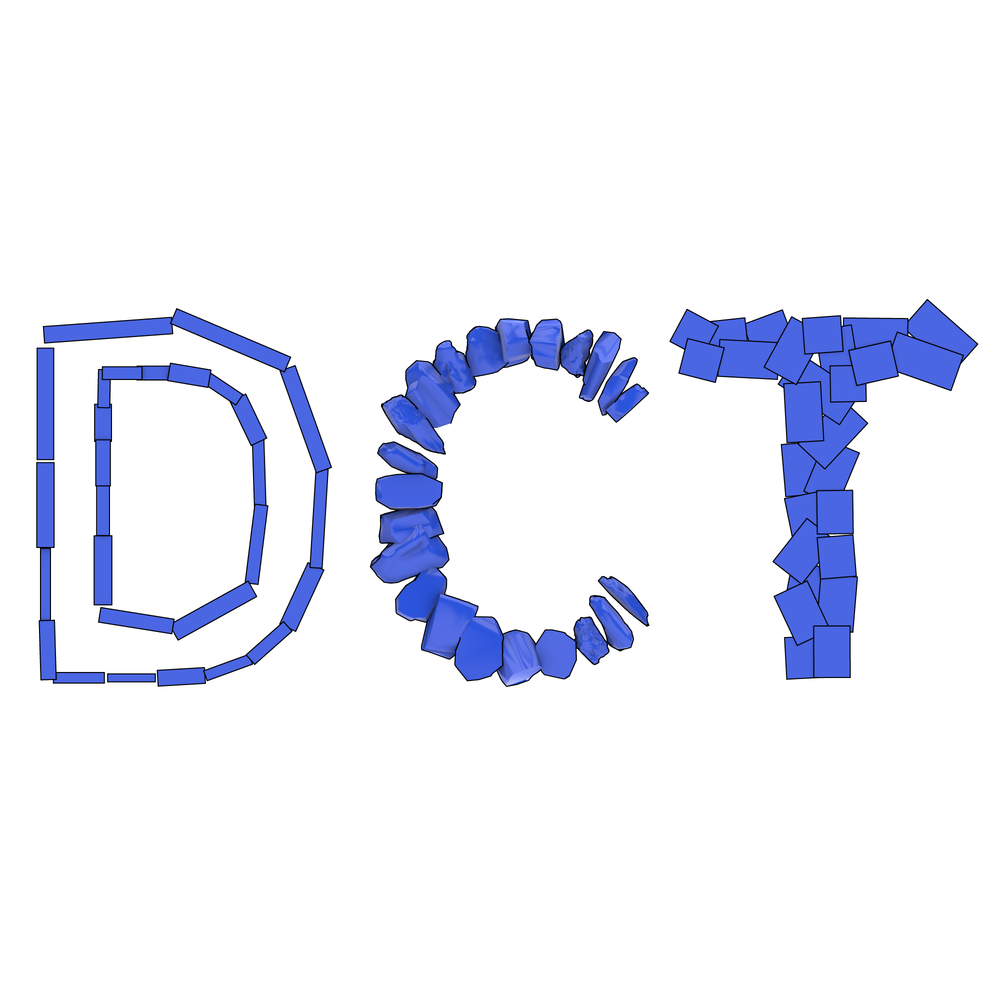

# DigitalCircularityToolkit



**DigitalCircularityToolkit (DCT)** is a Grasshopper plugin for inventory-driven design: designing with what already exists, such as reclaimed timber, salvaged steel, offcut plates or scanned stones. It takes arbitrary geometry (curves, Breps, meshes, point clouds), abstracts each piece as a line, plane, box or sphere, describes it with numbers, and finds the best assignment of the available pieces to the parts of a design.

```@raw html
<video class="dct-video" controls loop muted playsinline preload="metadata" poster="assets/media/trusses.jpg">
  <source src="assets/media/trusses.mp4" type="video/mp4">
</video>
```

## The workflow in five steps

Every DCT definition follows the same chain. Each step has a concept page and a set of components:

1. **Objects:** turn demand geometry (the design) and supply geometry (the inventory) into *design objects*. DCT finds each object's principal axes with PCA, measures it in that frame and abstracts it as a line, plane, box or sphere. See [Design objects](concepts/design-objects.md) and [Orientation](concepts/orientation.md).
2. **Sets:** expand objects by their quantity into one entry per physical piece. See [Inventories](concepts/inventories.md).
3. **Feature vectors:** describe every piece by the numbers that matter for the match: effective length, width, cross-section area, a shape descriptor. See [Feature vectors and cost matrices](concepts/cost-matrices.md) and [Shape descriptors](concepts/shape-descriptors.md).
4. **Cost matrix:** compute the cost of using each supply piece for each demand part.
5. **Match:** solve the assignment problem for the lowest total cost, then draw the assignment and move the matched pieces into place. See [Matching](concepts/matching.md).

The [Workflows](workflows/linear.md) section walks through complete definitions, each with a downloadable `.gh` file. Every component is documented in the [Component reference](components/index.md).

## Installation

DCT runs in Rhino 8 (Windows and Mac). Download the latest release from the [GitHub releases page](https://github.com/keithjlee/DigitalCircularityToolkit/releases) or [Food4Rhino](https://www.food4rhino.com/en/app/digitalcircularitytoolkit?lang=en). Step-by-step instructions are in [Getting started](getting-started.md).

## Citing

When using or extending DCT for research, please cite it:

```
@software{keith_j_lee_2026_24426828,
  author       = {Keith J. Lee and
                  Karl-Johan Soerensen},
  title        = {keithjlee/DigitalCircularityToolkit:
                   DigitalCircularityToolkit v0.5.2
                  },
  month        = nov,
  year         = 2026,
  publisher    = {Zenodo},
  version      = {v0.5.2},
  doi          = {10.5281/zenodo.24426828},
  url          = {https://doi.org/10.5281/zenodo.24426828},
}
```

APA:

```
Keith J. Lee, & Karl-Johan Soerensen. (2026). keithjlee/DigitalCircularityToolkit: DigitalCircularityToolkit v0.5.2 (Version v0.5.2) [Computer software]. Zenodo. https://doi.org/10.5281/zenodo.24426828
```

This cites the latest release, v0.5.2 ([10.5281/zenodo.24426828](https://doi.org/10.5281/zenodo.24426828)). To cite DCT without a specific version, use the concept DOI [10.5281/zenodo.10724609](https://doi.org/10.5281/zenodo.10724609), which always resolves to the newest release. Other citation styles are on the [Zenodo record](https://doi.org/10.5281/zenodo.24426828). DCT provides a generalized approach to the Digital Circularity workflow outlined by [Cousin et al](https://scholar.google.com/citations?view_op=view_citation&hl=en&user=0RMLrVgAAAAJ&sortby=pubdate&citation_for_view=0RMLrVgAAAAJ:VLnqNzywnoUC).

## About

DCT is developed by [Keith J. Lee](https://keithjlee.com) (MIT Building Technology, Digital Structures). [Karl-Johan Soerensen](https://github.com/soerensenkarl) developed I/O workflows with Google Sheets and CSV files. DCT was first used in the MIT design workshops *4.181 Digital Circularity: Tooling up for reuse with Odds & Mods* (IAP 2024) and *4.185 ODDS & MODS Castaways* (Spring 2024). Source code and issues: [github.com/keithjlee/DigitalCircularityToolkit](https://github.com/keithjlee/DigitalCircularityToolkit).
