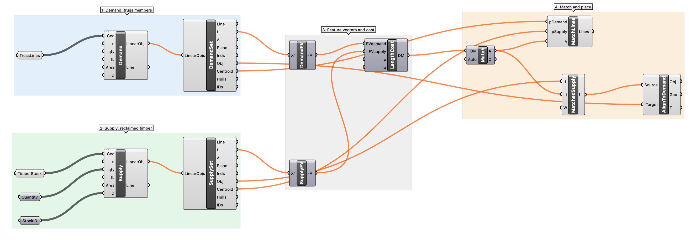

# Linear members from stock

Match the members of a structure to an inventory of reclaimed linear elements (timber, steel sections, tubes), so that every member gets a piece that is long enough, with as little waste as possible.

```@raw html
<video class="dct-video" controls loop muted playsinline preload="metadata" poster="../assets/media/trusses.jpg">
  <source src="../assets/media/trusses.mp4" type="video/mp4">
</video>
```

**Example file:** [`01_linear_truss.gh`](../assets/examples/01_linear_truss.gh). The demand is a 12 m Warren truss (31 members); the supply is 24 reclaimed timber pieces between 1.2 m and 4.5 m long, each with a quantity of 1 to 3 and an ID. Units are millimetres.



## 1. Demand

The truss lines go into a [`LinearObject`](@ref comp-LinearObject) and then a [`LinearSet`](@ref comp-LinearSet). For straight lines the effective length is the line length. The set provides each member's `EffectiveLength`, `Centroids` and `Objects`.

## 2. Supply

The timber Breps go into a second `LinearObject`, together with the `Quantity` and `ID` lists. PCA finds each piece's length direction, whatever its orientation in the model, and `Length` is the extent along it. The supply `LinearSet` expands each piece by its quantity: the 24 pieces with quantities 1–3 become one entry per physical piece. The `Indexer` and `IDs` outputs map each entry back to the inventory.

To account for damaged ends, set the supply `LengthBuffer` below 1 (for example 0.95). To match by cross-section as well, give the supply objects an `Area` (or let DCT estimate it from the bounding box) and add `Area` to the feature vectors.

## 3. Feature vectors and cost

Each side gets a [`FeatureVector`](@ref comp-FeatureVector) with one feature, `EffectiveLength`. [`AsymmEuclideanDistance`](@ref comp-AsymmEuclideanDistance) compares them: a piece at least as long as the member (it can be cut to length) costs the difference in length, with `Power1` = 1; a piece that is too short costs the difference squared (`Power2` = 2), which strongly discourages it. Because the lengths are in millimetres, the differences are large numbers and the integer rounding of the costs is negligible.

## 4. Match and place

[`Match`](@ref comp-Match) assigns one piece to every member at minimum total cost. [`MatchLines`](@ref comp-MatchLines) draws a line from each member to its piece. List Item picks the assigned supply objects (`Objects` of the supply set, indexed by `Assignment`), and [`AlignToObject`](@ref comp-AlignToObject) moves each onto its member. Each piece is centred on its member, so the overhang at both ends is the length to cut off.

## Variations

- **Several features:** add `Area` (or a required area from a structural analysis) as a second feature. Scale the features with [`PairNormalize`](@ref comp-PairNormalize) so that length in millimetres does not dominate area in square millimetres.
- **Structural analysis:** the members' required sizes can come from an analysis plugin such as Karamba3D, so that matching respects both length and capacity:

```@raw html
<video class="dct-video" controls loop muted playsinline preload="metadata" poster="../assets/media/karamba.jpg">
  <source src="../assets/media/karamba.mp4" type="video/mp4">
</video>
```

- **Shortage:** with fewer pieces than members, the unserved members get `-1` in `Assignment`. Filter them out before List Item (see [Matching](../concepts/matching.md)).
