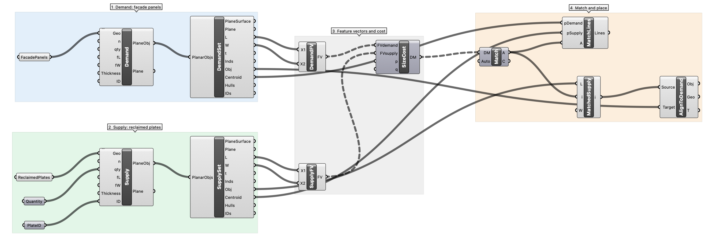

# Panels from reclaimed plates

Match the panels of a façade, floor or partition to an inventory of reclaimed sheets and plates, so that every panel can be cut from a plate that is large enough in both directions.

**Example file:** [`02_planar_panels.gh`](../assets/examples/02_planar_panels.gh). The demand is a façade of 15 rectangular panels (three rows of five columns, 0.9–1.5 m wide and 1 m high); the supply is 18 reclaimed plates of different sizes and thicknesses, each with a quantity of 1 or 2 and an ID. Units are millimetres.

## 1. Demand

The panel outlines (closed rectangles) go into a [`PlanarObject`](@ref comp-PlanarObject) and a [`PlanarSet`](@ref comp-PlanarSet). PCA puts `PCA1` along each panel's longer side and `PCA2` along the shorter side, so `EffectiveLength` ≥ `EffectiveWidth` for every panel. The same holds for the plates, which makes the two comparable without tracking which side is "horizontal".

## 2. Supply

The plate Breps go into a second `PlanarObject` with their `Quantity` and `ID`, then a `PlanarSet`. The thickness of each plate is its extent along `PCA3`, unless you supply a `Thickness`. Use `LengthBuffer` and `WidthBuffer` below 1 to keep a margin for trimming damaged edges.

## 3. Feature vectors and cost

Each side gets a [`FeatureVector`](@ref comp-FeatureVector) with two features, `EffectiveLength` and `EffectiveWidth`, connected in the same order on both sides. [`AsymmEuclideanDistance`](@ref comp-AsymmEuclideanDistance) treats a plate as valid only if it is at least as long *and* at least as wide as the panel; a plate that is too small in either direction gets the higher power `Power2`.

## 4. Match and place

[`Match`](@ref comp-Match), [`MatchLines`](@ref comp-MatchLines), List Item and [`AlignToObject`](@ref comp-AlignToObject) work exactly as in [Linear members from stock](linear.md). AlignToObject lays each plate in its panel's plane, centred on the panel, with the long sides aligned; the parts of the plate outside the panel are the offcuts.

## Variations

- **Thickness:** add `Thickness` as a third feature, or use [`EuclideanDistance`](@ref comp-EuclideanDistance) on thickness alone when plates must match a nominal thickness in both directions.
- **Square panels:** a square panel has no defined long side (see [Orientation](../concepts/orientation.md)); its `EffectiveLength` and `EffectiveWidth` are still correct, but its in-plane rotation is arbitrary. Use [`OverridePCA`](@ref comp-OverridePCA) when the rotation of the placed plate matters, for example for grain direction.
