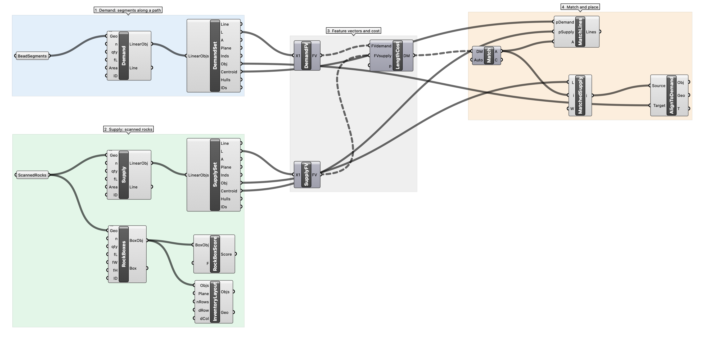

# Scanned objects

Work with irregular, scanned pieces such as rocks, rubble or found objects: abstract them, inspect how well each abstraction fits, lay the inventory out, and place pieces along a design. The example "beads" rocks along a path: each segment of the path gets a rock of matching length.

```@raw html
<video class="dct-video" controls loop muted playsinline preload="metadata" poster="../assets/media/beading.jpg">
  <source src="../assets/media/beading.mp4" type="video/mp4">
</video>
```

**Example file:** [`04_scanned_rocks.gh`](../assets/examples/04_scanned_rocks.gh). The demand is a curved path divided into segments of 280–520 mm with small gaps; the supply is thirty scanned rocks (meshes). Units are millimetres.



## 1. Demand: segments along a path

The segments go into a [`LinearObject`](@ref comp-LinearObject) and [`LinearSet`](@ref comp-LinearSet), which give each segment's length and position.

## 2. Supply: scanned rocks

The rock meshes go into a `LinearObject` and `LinearSet`. For meshes, DCT uses every vertex as a sample, so `NumSamples` has no effect; PCA finds each rock's longest direction, and `EffectiveLength` is its extent along that direction.

The same meshes also go into a [`BoxObject`](@ref comp-BoxObject), which serves two side tasks:

- [`BoxScore`](@ref comp-BoxScore) measures how well a box represents each rock (0 is a perfect box). Use the scores to sort an inventory, for example to separate block-like stones from round ones.
- [`Knoll`](@ref comp-Knoll) lays the whole inventory out on a grid, each rock turned so its longest axis runs along the grid's Y direction: a quick way to survey a scanned inventory.

## 3. Feature vectors and cost

Both sides get a [`FeatureVector`](@ref comp-FeatureVector) of `EffectiveLength`. Here [`EuclideanDistance`](@ref comp-EuclideanDistance) (`Power` 1) is used instead of the asymmetric metric, because rocks cannot be cut: a rock slightly shorter than its segment is as good as one slightly longer.

## 4. Match and place

[`Match`](@ref comp-Match) assigns a rock to each segment, and [`AlignToObject`](@ref comp-AlignToObject) moves each rock onto its segment, with its longest axis along the path.

## Variations

- **Orientation:** a rock's rotation about its long axis is set by its PCA frame. To control which face is up, override the frame with [`OverridePCA`](@ref comp-OverridePCA) or rotate it with [`RotatePCA`](@ref comp-RotatePCA) before aligning.
- **Volumetric matching:** use [`BoxObject`](@ref comp-BoxObject) and [`BoxSet`](@ref comp-BoxSet) with length, width and height as features to fill boxes (gabions, wall courses), or [`SphericalObject`](@ref comp-SphericalObject) and [`SphereSet`](@ref comp-SphereSet) when only overall size matters.
- **Heavy scans:** dense meshes (hundreds of thousands of vertices) are analyzed in parallel; enable Grasshopper's Parallel Computing option on the constructor. Reducing the meshes first is still the fastest option.
