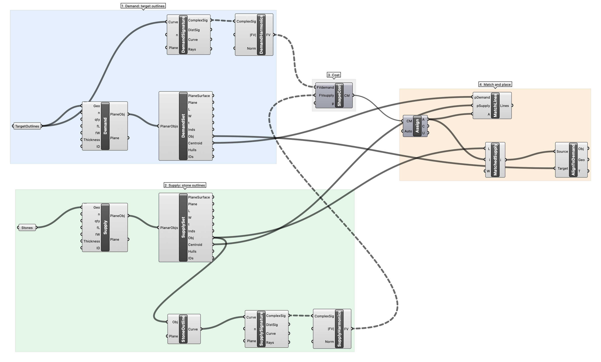

# Matching by shape

Fill a pattern of cells with irregular pieces, such as stones for a paving or offcuts for a mosaic, so that each cell gets the piece whose outline resembles it most. Dimensions alone cannot tell a triangle from a rectangle of the same size; [Shape descriptors](../concepts/shape-descriptors.md) can.

```@raw html
<video class="dct-video" controls loop muted playsinline preload="metadata" poster="../assets/media/tiling.jpg">
  <source src="../assets/media/tiling.mp4" type="video/mp4">
</video>
```

**Example file:** [`03_shape_tiling.gh`](../assets/examples/03_shape_tiling.gh). The demand is nine convex cells of five to eight sides; the supply is twenty flat stones (meshes). Units are millimetres.



## 1. Demand: target outlines

The cell outlines go into [`RadialSignature`](@ref comp-RadialSignature) (64 samples) and then [`HarmonicAnalysisComplex`](@ref comp-HarmonicAnalysisComplex), which keeps the first 8 values (`FVLength`). Each cell becomes one branch of eight numbers: the radii `|c1|, |c-1|, |c2|, |c-2|, ...` of the circles that trace its outline. The cells also go into a [`PlanarObject`](@ref comp-PlanarObject) and [`PlanarSet`](@ref comp-PlanarSet), for placing the stones later.

## 2. Supply: stone outlines

The stone meshes go into a `PlanarObject` and `PlanarSet`. [`PlanarOutline`](@ref comp-PlanarOutline) returns each stone's outline seen from above in its own frame (its "shadow" on its local plane), and the outlines get the same signature and harmonics as the cells.

The descriptors do not depend on where an outline is, how it is rotated, where it starts, or which way it runs, so the cells and the stones can be compared directly.

## 3. Cost

The harmonics already have one branch per object, the layout the cost components expect, so they go straight into [`EuclideanCost`](@ref comp-EuclideanCost) without a FeatureVector component. With `Power` 1 the cost is the distance between the descriptors, in millimetres.

## 4. Match and place

[`Assign`](@ref comp-Assign) picks a different stone for each cell. [`AlignToObject`](@ref comp-AlignToObject) moves each stone onto its cell by matching their PCA frames: centres coincide and the long directions align.

## Variations

- **Shape regardless of size:** set `Normalize` to true on both harmonics components. The descriptors then compare proportions only; add the effective length and width as further features (for example with [`FeatureVector`](@ref comp-FeatureVector) and [`PairNormalize`](@ref comp-PairNormalize)) to control size separately.
- **Fewer values:** `FVLength` 4–8 captures overall proportions; more values add detail and noise.
- **Distance signature:** [`HarmonicAnalysisReal`](@ref comp-HarmonicAnalysisReal) on the `DistanceSignature` is a simpler descriptor (how the radius varies around the outline). It cannot distinguish some shapes the complex descriptor can.
- **Checking a match:** [`HausdorffDistanceCurve`](@ref comp-HausdorffDistanceCurve) measures how far an aligned stone's outline is from its cell.
